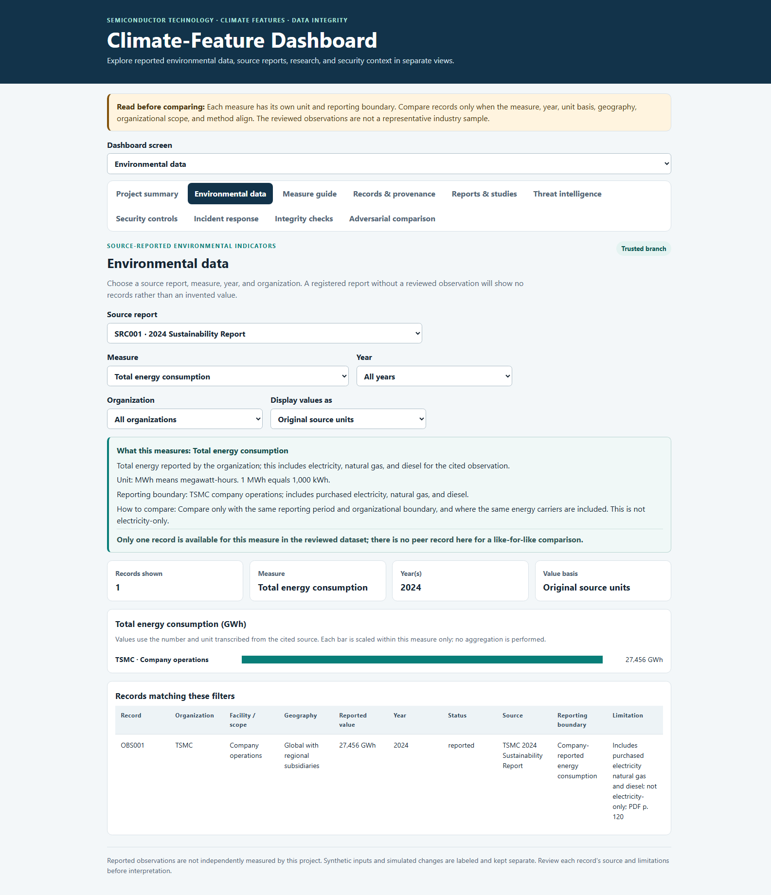

# Semiconductor Climate Data Dashboard

A local, source-aware dashboard that explores semiconductor-related environmental data and demonstrates how data manipulation can mislead users.

## Purpose

The project presents selected energy, water, and greenhouse-gas observations with their sources, units, years, geography, reporting boundaries, and limitations. A separate, intentionally altered dataset demonstrates why provenance and integrity checks matter.

This is a classroom proof of concept—not a complete industry footprint or company-ranking tool.

## Dashboard preview



The screenshot shows the local browser prototype, not Power BI Desktop.

## Run the dashboard

You need **Python 3.10 or newer**. From the repository root, run the command for your terminal:

| Platform | Command |
| --- | --- |
| Windows PowerShell | `.\run.ps1` |
| Windows Command Prompt | `run.cmd` |
| macOS or Linux | `./run` |

The launcher prepares the data, starts the local server, and opens the dashboard. First launch may need internet access to install dependencies. Stop the server with **Ctrl+C**.

The dashboard is local-only and is intended for use in a browser on the same computer. See the [dashboard guide](docs/dashboard_local.md) for troubleshooting and optional shell shortcuts.

## How the data workflow works

1. Register sources and record-level observations, including source locators and original units.
2. Validate required fields, metric/unit pairs, source links, and record structure.
3. Generate the trusted dataset and integrity reference.
4. Keep synthetic test data and intentional manipulations separate from reviewed observations.
5. Review the trusted and controlled adversarial views in the dashboard.

A matching SHA-256 value checks bytes against a reference; it does not prove that a source claim is true, complete, or independently audited.

## Data and limitations

The reviewed dataset contains **seven source-checked observations** from company reports and US EPA sources. The observations use different years, geographies, reporting boundaries, and definitions; they cannot support an industry-wide estimate, trend, or company ranking.

Synthetic test data and manipulated records are separate from the reviewed observations and are not research findings. The project includes a **Power BI import-ready CSV model**, not a completed native `.pbix` or `.pbip` report. The browser dashboard is the primary interactive dashboard.

## Repository guide

**Research and deliverables**
- [Week 1 deliverables](docs/week1_deliverables.md)
- [Final project report](docs/final_report.md)
- [Literature review](docs/literature_review.md)
- [Project proposal](docs/proposal.md)
- [Project plan and status](docs/project_plan.md)

**Data and methods**
- [Data-source plan](docs/data_source_plan.md)
- [Data dictionary](docs/data_dictionary.md)
- [Source collection guide](docs/collecting_sources_and_data.md)
- [Requirement traceability](docs/requirement_traceability.md)

**Dashboard and security**
- [Dashboard setup and views](docs/dashboard_local.md)
- [Demo runbook](docs/demo_runbook.md)
- [System architecture](docs/system_architecture.md)
- [Threat model](docs/threat_model.md)
- [Incident response](docs/incident_response.md)
- [Optional Power BI setup](docs/power_bi_setup.md)
- [Dashboard evidence screenshots](evidence/README.md)

## Tests

Install development dependencies and run the test suite:

```powershell
python -m pip install -r requirements-dev.txt
python -m pytest
```
