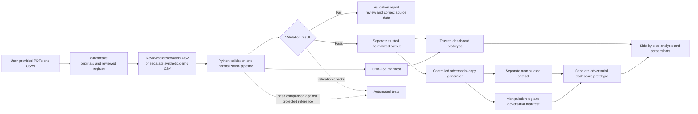

# Dashboard system and data-flow architecture

This is the local prototype architecture. A control shown below is a design requirement, not evidence that an enterprise identity, encryption, signing, or audit service has been deployed. The source-backed intake and the synthetic demo use separate output directories; neither replaces the other.

## Trust boundaries and controls

1. **Source to intake:** Preserve supplied originals and citations. Do not silently correct source data. Record transformations separately, verify source metadata, and control write access.
2. **Raw input to pipeline:** Treat input as untrusted. The pipeline checks required fields, identifiers, numeric values, years, units, and allowed statuses, then fails visibly and preserves a validation report. Source-register linkage and completeness of required feature coverage still require a separate reviewer check; they are not all enforced automatically by the current validator.
3. **Pipeline to trusted output:** Keep generated output separate from its input. The reviewed and demo datasets use separate output directories. Record a version and SHA-256. Protect the known-good manifest independently; a writable adjacent hash file alone does not authenticate data.
4. **Trusted data to dashboard:** Restrict report/model edits, preserve source lineage, and independently review filters, axes, labels, units, reporting boundaries, and refresh results.
5. **Trusted to adversarial branch:** Copy trusted output before modification. Never write manipulated records back to raw or trusted files. Log every controlled change and label all adversarial outputs.
6. **Report to evidence/submission:** Capture screenshots from actual report versions and retain the report, datasets, validation output, and change log needed to reproduce each comparison.

## Design requirements

- Use least privilege and MFA for any shared account or cloud repository; encrypt data in transit and at rest where the storage platform supports it.
- Use version control, protected backups, and review/approval for trusted data or report changes.
- If an actor can alter both a dataset and its manifest, use a separately controlled digital signature/HMAC key or trusted artifact store; a plain SHA-256 file beside the dataset is not sufficient.
- Record who/when changed files only when backed by platform audit logs. Local file timestamps and Git history alone do not reliably prove person-level attribution.
- Clearly distinguish implemented demo controls from proposed organizational controls in the report.
